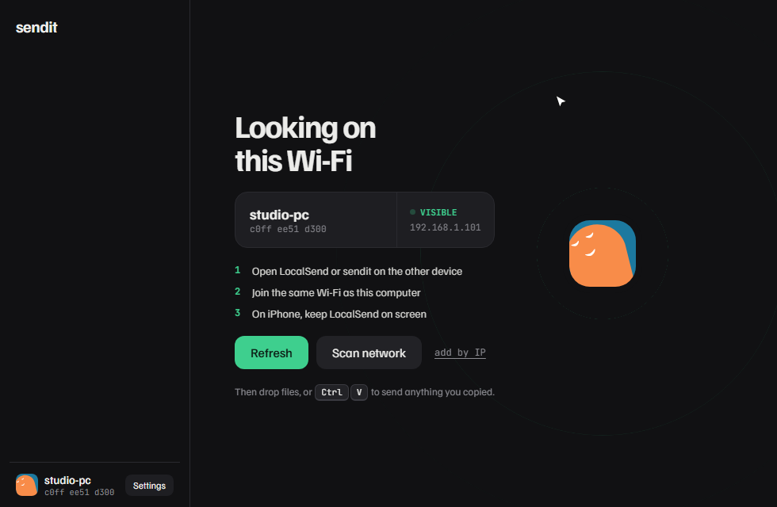
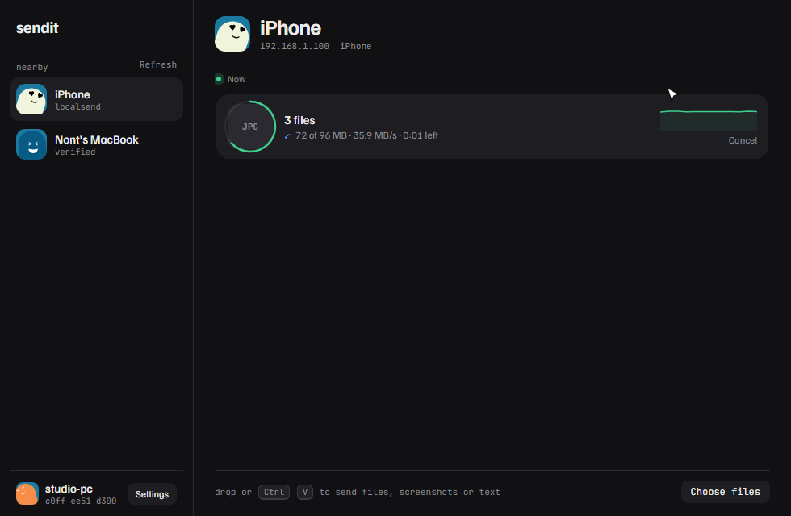
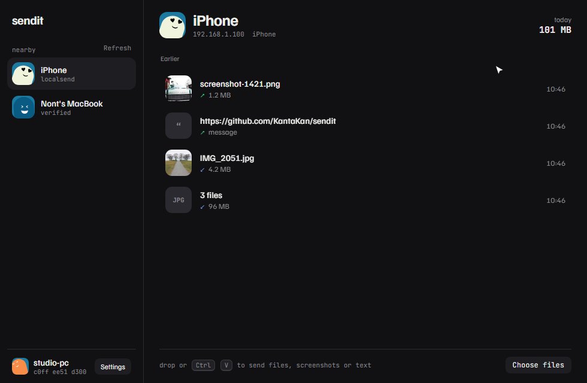

# sendit

**LocalSend-compatible file transfer for Windows, macOS and Linux.** It sends files, folders, screenshots and text to the LocalSend app on your phone (and to other sendit computers) over your Wi-Fi. No cloud, no account.

Higher quality: [demo.mp4](docs/media/demo.mp4)

| Finding devices | Receiving | History |
|---|---|---|
|  |  |  |

## What it does

- **Works with LocalSend.** Phones and computers that run LocalSend (protocol v2, including 2.2's mutual TLS) see sendit and can trade files with it in both directions.
- **Drop or paste to send.** Drag files into the window, or press <kbd>Ctrl</kbd>/<kbd>Cmd</kbd>+<kbd>V</kbd> to send whatever you copied: files, folders, a screenshot, or text. Text shows up on the phone as a message.
- **A timeline, not a progress dialog.** Incoming requests, live transfers (with a speed graph and time left) and finished items with photo thumbnails. Right-click any item to show it in its folder, copy it, retry it, or remove it.
- **End-to-end encrypted, and harder to fool than plain LocalSend.** Device to device over TLS, with key pinning and trust-on-first-use. See [Security](#security).
- **Safe receiving.** You accept each request (or auto-accept trusted devices). Files never land outside your download folder, never overwrite anything, and are only ever *revealed* in your file manager, never opened.
- **A CLI too:** `sendit devices`, `sendit send <files> --to <name>`, `sendit receive`.

## Install

**Download:** grab the installer for your system from [Releases](https://github.com/KantaKan/sendit/releases/latest).

- **Windows:** `sendit_x.y.z_x64-setup.exe`. Run it, then search **sendit** in the Start menu. The app is not code-signed yet, so SmartScreen may say "Windows protected your PC": click *More info*, then *Run anyway*.
- **macOS:** the `.dmg`. On first launch, right-click the app and choose *Open*.
- **Linux:** the `.AppImage` or `.deb`.

**From a clone (Windows):** with [Rust](https://rustup.rs) (MSVC toolchain) and [Node.js](https://nodejs.org) installed:

    git clone https://github.com/KantaKan/sendit
    cd sendit
    powershell -ExecutionPolicy Bypass -File .\install.ps1

It builds the app and installs it for your user. Uninstall it from Settings, Apps.

## Security

Everything goes **directly between your two devices over your own network, encrypted end to end with TLS**. There is no server in the middle and nothing leaves your Wi-Fi.

On top of what LocalSend does, sendit makes sure the device you are talking to is the one you think it is:

| Risk on a shared Wi-Fi | What sendit does |
|---|---|
| Someone sits in the middle of the connection | Each device's TLS certificate is **pinned to the fingerprint it announced**. A different certificate means the connection is dropped. |
| Someone pretends to be your laptop (same name, different device) | **Trust on first use:** a device's key is remembered the first time. A familiar name with a new key is flagged *key changed*, and nothing is sent until you choose *Block* or *It's a reinstall*. |
| A sender lies about who it is | Before you see a request, sendit **calls the sender back, pinned to the key it claimed**. If that fails, the request is labelled *Unverified sender*. Unproven claims never touch your trusted-device list. |
| First contact between two sendit computers | Both screens show the **same pair of faces** (derived from both keys); you compare them by eye. |
| Mutual authentication | sendit always **presents its own certificate** (mutual TLS), as LocalSend 2.2 requires. |
| Malicious file names (`../../Windows/...`) | Names are cleaned per folder level; files can only land **inside your download folder**, even through junctions or symlinks, and never overwrite existing files. |
| Unwanted files | Every request needs your **Accept** (or a trusted, verified device you chose to auto-accept). Optional PIN, with **lockout after 5 wrong guesses**. |
| Dangerous files | Received files are only ever **revealed in your file manager**, never opened by sendit. |

Each of these is covered by automated tests (impersonation, certificate mismatch, path traversal, PIN brute force, abandoned requests, dropped and stalled connections) that run on Windows, macOS and Linux in CI.

## Run from source

You need [Rust](https://rustup.rs) and [Node.js](https://nodejs.org). On Windows, Rust must use the MSVC toolchain.

    git clone https://github.com/KantaKan/sendit
    cd sendit/app
    npm install
    npm run tauri dev        # the desktop app
    npm run dev:mock         # UI only, in a browser, with a fake backend

CLI:

    cargo run -p sendit-cli -- devices
    cargo run -p sendit-cli -- send photo.jpg album/ --to "iPhone"
    cargo run -p sendit-cli -- receive

Build installers yourself: `cd app && npm run tauri build`. Releases are built by CI when a `v*` tag is pushed.

If your phone doesn't show up, check that both are on the same Wi-Fi, and on iPhone keep LocalSend open on screen (iOS pauses it in the background).

## How it's built

A Rust core (`crates/core`) speaks the [LocalSend protocol](https://github.com/localsend/protocol) by hand: UDP multicast discovery, an HTTPS server and client on rustls with certificate pinning, and a trust-on-first-use store. The desktop app is Tauri 2 with Svelte 5. Tests cover the protocol, security cases (impersonation, path traversal, PIN brute force), network chaos (dropped, throttled and stalled links) and the UI flows in a real browser.

Design notes: [docs/design](docs/design). Interop checklist: [docs/interop-checklist.md](docs/interop-checklist.md).

The demo above is generated: `cd app && DEMO=1 npx playwright test e2e/demo.spec.ts`.

Not affiliated with LocalSend. License: Apache-2.0.
